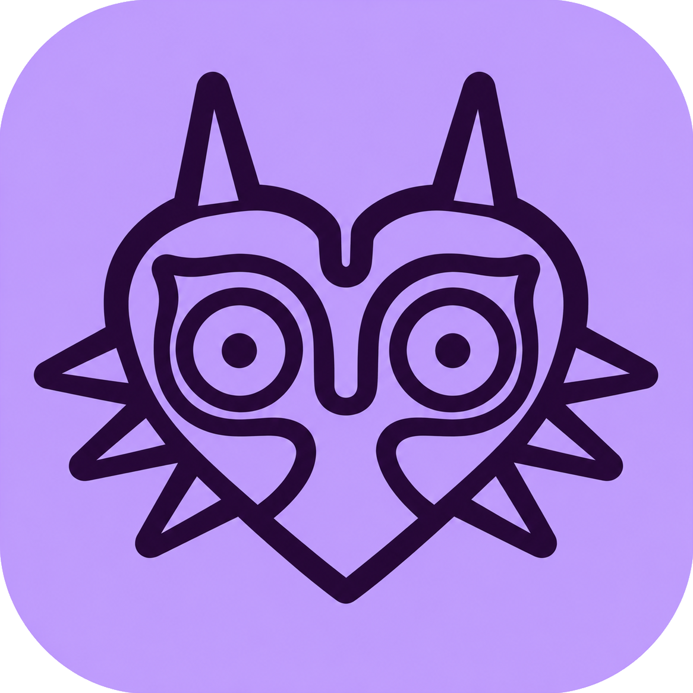

# Major



Major porta lo schermo di Android, iPhone e iPad sul desktop Windows, con un’interfaccia unica, temi chiaro e scuro e nessun abbonamento obbligatorio.

## Download

- [Major per Windows x64 — versione 0.5.1](https://github.com/Megami-Hylia/Major/releases/download/v0.5.1/Major-0.5.1-win-x64.zip)
- [Major per Android — APK 0.3.0](https://github.com/Megami-Hylia/Major/releases/download/v0.5.1/Major-Android-0.3.0-debug.apk)
- [Tutte le release](https://github.com/Megami-Hylia/Major/releases)

Su Windows estrai **tutto** lo ZIP e apri `Major/Major.exe`, mantenendo DLL e cartelle accanto all’eseguibile. Il runtime .NET è incluso. L’APK è una build debug installabile su Android 8 o successivo.

## Funzioni

- Android USB/ADB: mirroring e controllo con mouse e tastiera tramite scrcpy, qualità configurabile, screenshot e registrazione.
- Android Wi-Fi: associazione con codice temporaneo, consenso MediaProjection e trasmissione video cifrata dalla companion al PC.
- iPhone/iPad: ricezione nativa da **Centro di Controllo → Duplica schermo**, con codice di associazione, video e audio tramite UxPlay.
- Viewer integrato per i ricevitori Wi-Fi, rotazione e proporzioni corrette, barra laterale compatta e impostazioni persistenti.

PC e dispositivo devono trovarsi sulla stessa rete locale per le modalità Wi-Fi. AirPlay riceve schermo e audio e non offre controllo remoto. La companion Android trasmette solo video; controllo e acquisizioni appartengono al percorso USB/ADB. I contenuti protetti possono non essere visualizzati.

## Contenuto del repository

- `PC/`: sorgenti desktop WPF/.NET 8, test, script, licenze, manifest delle dipendenze e sorgenti modificati di UxPlay.
- `Android/`: **solo l’APK**, senza sorgenti dell’app mobile.
- [Releases](https://github.com/Megami-Hylia/Major/releases): pacchetto Windows completo, APK e checksum. Il pacchetto Windows include dipendenze, licenze e sorgenti accompagnatori dei componenti distribuiti.

## Sviluppo Windows

```powershell
.\PC\scripts\Restore-ReleaseDependencies.ps1
.\PC\scriptsootstrap.ps1 -InstallSdk
.\PC\scriptsuild.ps1
```

Il primo comando acquisisce la release Windows verificata tramite SHA-256 e ripristina le dipendenze escluse da Git. Il bootstrap installa localmente l’SDK fissato; non serve una sottoscrizione. La build viene generata in `PC/build/Major`. Per l’utente finale è sufficiente il pacchetto Windows già pronto.

## Verifiche e limiti

I test software comprendono ADB/processi, TLS/decodifica, lifecycle AirPlay, interfaccia e simulazione dei messaggi di fine sessione Windows. La versione 0.5.1 corregge un crash riprodotto nella chiusura della finestra. La prova fisica di AirPlay confermata dall’utente riguarda iPad 9 con iPadOS 26.4 e il backend precedente all’ultimo aggiornamento grafico: non viene dichiarata compatibilità universale. L’ultimo aggiornamento non è stato collaudato con un vero spegnimento o su ulteriori dispositivi fisici.

## Licenze

Il codice originale di Major è MIT. Le dipendenze mantengono le proprie licenze, incluse quelle di scrcpy, ADB, UxPlay, GStreamer e FFmpeg. Consulta [gli avvisi completi](PC/THIRD_PARTY_NOTICES.md) e i file in `PC/third-party`. Le denominazioni e i personaggi di terzi appartengono ai rispettivi titolari.
